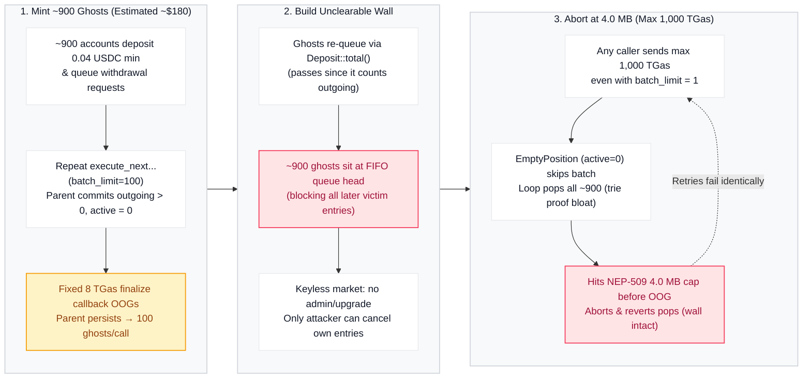
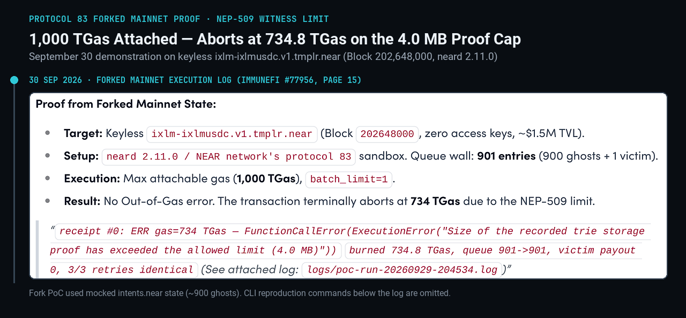
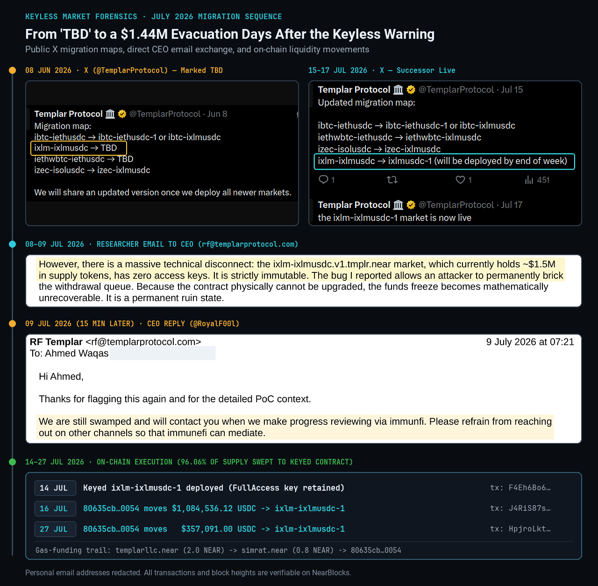
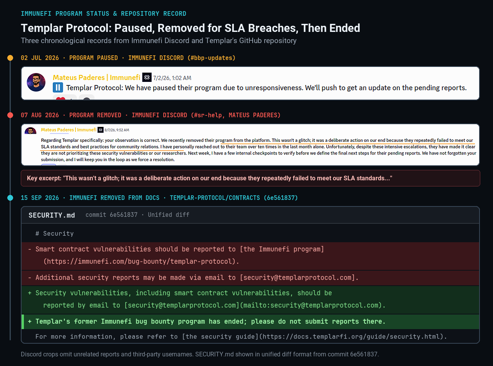
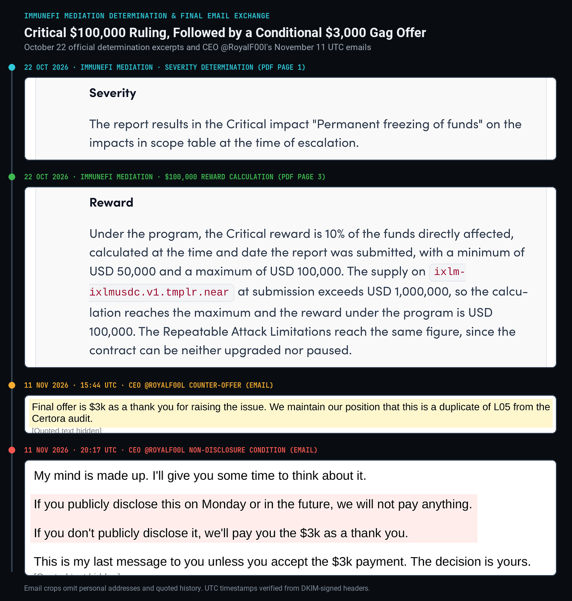

> **Supplier safety notice:** Two keyless markets cannot be patched: [`ixlm-ixlmusdc.v1.tmplr.near`](https://nearblocks.io/address/ixlm-ixlmusdc.v1.tmplr.near) (59,137.97 USDC active; 40,456.41 USDC `available`) and [`izec-isolusdc.v1.tmplr.near`](https://nearblocks.io/address/izec-isolusdc.v1.tmplr.near) (250.03 USDC active; 4.33 USDC `available`). Existing suppliers in these two markets should check limits and liquidity before withdrawing via the [official interface](https://app.templarfi.org) while queues remain empty.
{: .prompt-danger }

*Disclosed under [Immunefi Category 2](https://immunefi.com/responsible-publication/) ([attached Oct 22 Mediation Determination PDF](/assets/docs/templar/immunefi-77956-mediation-summary.pdf)).*

---

## 1. Executive Summary

On May 13, 2026, I submitted Immunefi Report #77956 disclosing a critical supply-withdrawal freeze in Templar Protocol on NEAR, expanding scope on May 16 to 18 lending markets holding ~$4.75M. Two defects in Templar's withdrawal queue let an attacker trigger a fixed 8 TGas callback failure that refunds 100% of principal while leaving zero-balance "ghost" entries behind, forcing subsequent withdrawal calls into NEAR's 4.0 MB NEP-509 storage-proof limit where execution aborts and every removal reverts. One market in scope, `ixlm-ixlmusdc.v1.tmplr.near` ($1,500,766.54 USDC active supply), had deleted its sole `FullAccess` key 114 days earlier, leaving no admin, pause, or upgrade recovery path.

Over the next five months, triage stalled on Immunefi, prompting the platform to pause (July 2) and remove (August 7) Templar's public bug bounty program for repeated SLA breaches. On-chain, remediation moved ahead: six days after my July 8 email warning CEO @RoyalF00l about the keyless pool, a keyed replacement (`ixlm-ixlmusdc-1.v1.tmplr.near`) deployed and $1,441,627.12 USDC (96% of supply, signed by an account gas-funded via `templarllc.near` → `simrat.near`) moved into it. After confirming my September 30 1,000 TGas forked-mainnet proof on October 2, Templar upgraded 22 keyed markets (~$15.40M active supply) on October 7–8. Nine hours later, the team offered a $2,500 goodwill payout and claimed #77956 duplicated Certora finding L-05, even though git history shows the vulnerable batch loop landed 40 days after Certora's manual review closed.

On October 22, 2026, Immunefi Mediation rejected Templar's griefing, Sybil, and L-05 defenses and upheld **Critical: Permanent freezing of funds** at the **$100,000 USD** cap. Hoping to resolve the report cooperatively, I offered a 40% reduction ($60,000), which went unanswered through its November 8 deadline. On November 11, @RoyalF00l made a final offer of $3,000, conditioned on this post-mortem never being published.

| Field | Verified Record |
| :--- | :--- |
| **Report & Scope** | Immunefi #77956 (submitted May 13, 2026) across `v1.tmplr.near` markets (v1.2.0–v1.3.0) |
| **Keyless Exposure** | `ixlm-ixlmusdc.v1.tmplr.near` ($1,500,766.54 USDC, 0 access keys since Jan 19, 2026) |
| **On-Chain Mitigation** | $1.44M USDC moved out in July; 22 keyed markets ($15.40M TVL) patched Oct 7–8 |
| **Mediation Ruling** | **Critical: Permanent freezing of funds ($100,000 USD cap)** on Oct 22, 2026 |
| **Final Protocol Offer** | $3,000 conditioned on permanent non-disclosure; $0 if published |

---

## 2. Technical Root Cause: Chaining the 8 TGas Callback, `EmptyPosition`, and NEP-509

Unlike EVM atomic transactions, a `.then(...)` callback on NEAR executes in a separate receipt: if it runs out of gas, parent storage writes and sibling token-transfer receipts remain committed on-chain. Both reported v1.3.0 ([`e1f5b676`](https://github.com/Templar-Protocol/contracts/commit/e1f5b6766c8f69b2e89315241cf8f30a9caa3c4c)) and keyless v1.2.0 ([`877cdf79`](https://github.com/Templar-Protocol/contracts/tree/877cdf7935a87f365deed8b3f51dcb268f36443c)) share the identical callback and queue loop, and the FIFO queue (`create_supply_withdrawal_request` → `execute_next_supply_withdrawal_request`) is the only path for borrow-asset tokens to exit a market.

### 2.1 Defect 1: Fixed 8 TGas Callback Mints Reusable "Ghost" Positions

`execute_next_supply_withdrawal_request(batch_limit)` is permissionless. In the outer executor receipt, it deducts active supply balances, moves payable amounts into `outgoing`, schedules outbound NEP-141 / NEP-245 token transfers, and chains a single settlement callback with a hardcoded 8 TGas allowance:

```rust
// e1f5b676 - contract/market/src/impl_market_external.rs:292-297
transfers.then(
    self_ext!(Self::GAS_EXECUTE_NEXT_SUPPLY_WITHDRAWAL_REQUEST_01_FINALIZE) // Fixed 8 TGas
        .execute_next_supply_withdrawal_request_01_finalize(batch, result),
)
```
{: file="contract/market/src/impl_market_external.rs" }

In [`impl_helper.rs`](https://github.com/Templar-Protocol/contracts/blob/e1f5b6766c8f69b2e89315241cf8f30a9caa3c4c/contract/market/src/impl_helper.rs#L175-L203), `GAS_EXECUTE_NEXT_SUPPLY_WITHDRAWAL_REQUEST_01_FINALIZE` is fixed at `Gas::from_tgas(8)`, yet `01_finalize` iterates across the entire `batch` to settle `record_withdrawal_final`, emit NEP-297 events, and process storage refunds. Callback work scales linearly with batch size, while callback gas stays constant.

When a caller supplies a sufficiently large batch, the outbound token transfers settle first (returning 100% of deposited principal to the caller), and `01_finalize` subsequently aborts with `ActionError::FunctionCallError(HostError::GasExceeded)`. Because parent state and completed transfers never roll back, each position remains stranded with `active == 0`, `incoming == []`, `yield == 0`, and `outgoing > 0`, while the caller recycles the exact same principal across accounts.

### 2.2 Defect 2: `Deposit::total()` Re-Entry Meets an Unbounded `EmptyPosition` Walk

Under normal conditions, a zero-balance account cannot enter the withdrawal queue. However, `create_supply_withdrawal_request` gates entry using [`Deposit::total()`](https://github.com/Templar-Protocol/contracts/blob/e1f5b6766c8f69b2e89315241cf8f30a9caa3c4c/common/src/supply.rs#L29-L35), which sums `active + outgoing`:

```rust
// e1f5b676 - common/src/supply.rs:29-35
pub fn total(&self) -> BorrowAssetAmount {
    let mut total = self.active + self.outgoing; // Ghost passes check via outgoing > 0
    for incoming in &self.incoming {
        total += incoming.amount;
    }
    total
}
```
{: file="common/src/supply.rs" }

Every stranded ghost position therefore passes validation and re-enters the queue. When any honest supplier or keeper subsequently calls `execute_next_supply_withdrawal_request(batch_limit)`, even with `batch_limit = Some(1)`, `record_withdrawal_initial` evaluates `active + incoming + yield == 0` and returns `WithdrawalAttempt::EmptyPosition`:

```rust
// e1f5b676 - contract/market/src/impl_market_external.rs:220-260 (abridged)
let batch_limit = batch_limit.unwrap_or(1);
while let Some((account_id, requested_amount)) = self.withdrawal_queue.peek() {
    if batch.len() >= batch_limit as usize {
        break; // Only counts fulfilled withdrawals pushed to `batch`
    }
    // ...
    match withdrawal_attempt {
        WithdrawalAttempt::EmptyPosition => {
            self.withdrawal_queue.pop(); // Mutates trie storage, does NOT advance batch.len()
            depth_cleared += requested_amount;
        }
        WithdrawalAttempt::Full(withdrawal) => {
            batch.push(withdrawal);      // Only path that increments batch.len()
            self.withdrawal_queue.pop();
            depth_cleared += requested_amount;
        }
        // WithdrawalAttempt::NoLiquidity | WithdrawalAttempt::Partial => { ... }
    }
}
```
{: file="contract/market/src/impl_market_external.rs" }

Because `EmptyPosition` pops the head entry without pushing to `batch`, `batch.len()` stays pinned at 0. Regardless of how small `batch_limit` is, the `while` loop cannot exit early; a single receipt is forced to walk and mutate every consecutive ghost entry at the head of the queue.



*Note: The parameters shown above (batch_limit = 100, ~900 accounts costing ~$180 in NEAR storage and gas) reflect the local mainnet-fork PoC, which used a mocked intents.near state. Executing this on live mainnet requires tuning batch_limit and queue depth to match actual on-chain cross-contract gas costs. In line with Immunefi Category 2 Responsible Publication guidelines, and because legacy keyless markets still hold user funds, exact mainnet-tuned parameters and weaponized exploit details are intentionally withheld.*

### 2.3 Why NEAR's 1,000 TGas Upgrade Did Not Save the Queue: NEP-509's 4.0 MB Proof Limit

On September 28, more than four months after submission, Templar raised a sharp protocol-level objection: my May 13 proof-of-concept had sized its queue wall against NEAR's historical 300 TGas limit, whereas NEAR Protocol 83 (`nearcore` 2.11.0) had raised `max_total_prepaid_gas` to 1,000 TGas (1 PGas) shortly before filing. With 1,000 TGas attached, a smaller wall could be cleared in one call.

Immunefi Mediation invited a max-gas test against the live state of keyless `ixlm-ixlmusdc.v1.tmplr.near`. Within 24 hours, on September 30, I ran the full 1,000 TGas execution on a local `neard` 2.11.0 mainnet fork (Block 202,648,000).

The transaction did not run out of gas. Instead, it terminally aborted at 734.8 TGas on [NEP-509 Stateless Validation's](https://github.com/near/NEPs/blob/master/neps/nep-0509.md) per-receipt storage-proof ceiling ([`per_receipt_storage_proof_size_limit`](https://github.com/near/nearcore/blob/2.11.0/core/parameters/res/runtime_configs/69.yaml#L3-L9) = 4,000,000 bytes, or 4.0 MB in decimal units).

Under stateless validation, every `withdrawal_queue.pop()` reads and deletes state in the contract's Merkle-Patricia trie, recording touched trie nodes into the chunk's `ChunkStateWitness`. Once recorded proof crosses 4,000,000 bytes inside a single receipt, `neard` aborts the receipt and **rolls back every `pop()` performed during that call**. The queue length after execution equals the queue length before execution, with roughly 265 TGas still unspent. On October 2, Templar confirmed this exact mechanism on the mediation record.

{: .shadow }
_September 30 forked-mainnet test (neard 2.11.0, Block 202,648,000) with the full 1,000 TGas attached, aborting at 734.8 TGas when recorded trie proof exceeds NEP-509's 4.0 MB cap._

### 2.4 What Templar's Patch (PR #659 / `dbfcd42b`) Actually Changed

In [PR #659](https://github.com/Templar-Protocol/contracts/pull/659) (commit [`dbfcd42b`](https://github.com/Templar-Protocol/contracts/commit/dbfcd42b4ee5565bffc05e652c07af463a2bdd19), authored October 7 at 21:52 UTC, 32 minutes before the first mainnet upgrade, and squash-merged October 12 as [`319ec3b`](https://github.com/Templar-Protocol/contracts/commit/319ec3b0a9022135ea6badd58f9e26447516c8eb)), [`withdrawal_queue_bounds.rs`](https://github.com/Templar-Protocol/contracts/blob/dbfcd42b4ee5565bffc05e652c07af463a2bdd19/contract/market/src/tests/withdrawal_queue_bounds.rs#L1-L9) documents the exact #77956 bug chain:

```rust
//! Bounds on `execute_next_supply_withdrawal_request`.
//!
//! A supply position whose `outgoing` was never settled by
//! `execute_next_supply_withdrawal_request_01_finalize` keeps a non-zero
//! `total_deposit()` — enough to re-enter the queue — while
//! `record_withdrawal_initial` scores it `EmptyPosition`. Two properties keep
//! such entries from stalling the queue for everyone else: the walk must charge
//! every visited entry against `batch_limit`, and the continuation must be
//! given gas proportional to the batch it has to settle.
```
{: file="contract/market/src/tests/withdrawal_queue_bounds.rs" }

Commit `dbfcd42b` counts every `visited` entry (including `EmptyPosition`) toward `batch_limit`, scales `01_finalize` gas to `6 TGas + 3 TGas * batch.len()`, and leaves `supply_withdrawal_range.minimum` untouched. On-chain NEP-330 metadata on the 22 upgraded markets reports v1.6.0 (`code_hash` `7WUFT7JR2mbKhQkPNedLL3ZZ28arqbwAFFubaMQpRpPW`, unpublished commit `07e20fc7`), so this post-mortem distinguishes public PR #659 from the deployed binary.

---

## 3. On-Chain Forensics: Keyless Immutability, the July $1.44M Sweep, and 22-Market Upgrades

On January 19, 2026 (Block 181,696,954), `ixlm-ixlmusdc.v1.tmplr.near` deleted its sole `FullAccess` key (`ed25519:5gEdy3qyZBZveGfcxcUTGCoVzzKnZXaQASWjmyP44giZ`) in transaction [`5PPCjn583spZKptMEo1gYN4zuhCRhnWKwsTKxag3FQFd`](https://nearblocks.io/txns/5PPCjn583spZKptMEo1gYN4zuhCRhnWKwsTKxag3FQFd). As [Templar's security documentation](https://docs.templarfi.org/guide/security-overview.html#immutable-markets) notes, a market with zero access keys is strictly immutable and cannot be patched in place. By contrast, all 22 newer active markets retained that exact shared `FullAccess` key, allowing Templar to upgrade five markets on August 28 and redeploy all 22 markets in place on October 7–8.

### 3.1 From "TBD" to $1,441,627.12 USDC Evacuated After the July 8 Warning

On [June 8, 2026](https://x.com/TemplarProtocol/status/2064025413656207577), @TemplarProtocol posted a legacy-market migration map listing `ixlm-ixlmusdc -> TBD`. For a full month, no replacement deployed and ~$1.50M USDC remained in the keyless pool while #77956 sat downgraded to "Medium" on Immunefi and the program was paused on July 2 for unresponsiveness.

Late on July 8, 2026 (July 9, 02:06 UTC), I emailed CEO @RoyalF00l (`rf@templarprotocol.com`) under the subject *"Immunefi Report #77956 - Immutable contracts and an 'absorbing barrier'"*, pointing out that `ixlm-ixlmusdc.v1.tmplr.near` held ~$1.5M with zero access keys, making a queue freeze unrecoverable. Fifteen minutes later (02:21 UTC), @RoyalF00l replied:

> *"Hi Ahmed, Thanks for flagging this again and for the detailed PoC context. We are still swamped and will contact you when we make progress reviewing via immunfi. Please refrain from reaching out on other channels so that immunefi can mediate."*

Within one week, on-chain execution moved rapidly:

1. **July 14 (19:29 UTC, Block 206,972,621):** `v1.tmplr.near` deployed [`ixlm-ixlmusdc-1.v1.tmplr.near`](https://nearblocks.io/txns/F4Eh6Bo6A1ufY6DLGXdHgYmJBXvHdrd5JdKc1mTGjBRU), retaining `FullAccess` key `ed25519:5gEdy3qy…` and raising `supply_withdrawal_range.minimum` from 0.04 to 1.00 USDC.
2. **July 15:** [@TemplarProtocol announced an updated migration map](https://x.com/TemplarProtocol/status/2077405583893057943) naming `ixlm-ixlmusdc -> ixlmusdc-1`.
3. **July 16 & July 27:** Implicit account `80635cbbea3bc03a112c72a30ad94059213a253db65f549c8c406e707d730054` withdrew 1,084,536.12 USDC ([`J4RiS87s…`](https://nearblocks.io/txns/J4RiS87shhxTjr3iWehUhngUFUuKPhNirUm197Vj5WRp)) and 357,091.00 USDC ([`HpjroLkt…`](https://nearblocks.io/txns/HpjroLktcytDkgFtenRc28ZTY2cUYEvszsrpfBkXVWt4)), re-supplying **$1,441,627.12 USDC** (96.06% of submission-time supply) into upgradeable `ixlm-ixlmusdc-1.v1.tmplr.near` within minutes ([`3kg2ddiR…`](https://nearblocks.io/txns/3kg2ddiRo85mb6NrsMQTE4Ze42bV7k9XZs5tqxigeUgT), [`5mpWq6CJ…`](https://nearblocks.io/txns/5mpWq6CJeqSxP4cnLLaHUv5bAx8s4nzBHk6F8J1sW8ci)).

{: .shadow }
_Sequence from June 8 (TBD) to the July 8–9 direct keyless warning email and the July 14–27 deployment and $1.44M USDC migration into keyed `ixlm-ixlmusdc-1`._

Archival NEAR transfers link `80635cb…0054`'s gas two hops to Templar's corporate account: `templarllc.near` sent 2.0 NEAR to `simrat.near` ([`3D76DGqz…`](https://nearblocks.io/txns/3D76DGqzaGhLvV6fdhqQ6FyoZHTwK1Q6ue65tkt7ortN)), which sent 0.8 NEAR to `80635cb…0054` ([`EiYoiesk…`](https://nearblocks.io/txns/EiYoieskajddQPRMU68eHp2yFffG8ZaHamHopdaUUg1Z)) right before its initial 1.5M USDC deposit ([`EgDkqFBY…`](https://nearblocks.io/txns/EgDkqFBYyUzX9VxGB6kyJD2fWzv9aK1fZufx5X145p6q)). This establishes the gas-funding chain, though not off-chain ownership of principal. Only 59,137.97 USDC remained after July 27 (99.98% held by `80635cb…0054` and `simrat.near`) because 92.96% of the pool was borrowed out; later repayments raised borrow-side `available` liquidity to 40,456.41 USDC, which sits unwithdrawn even as `revenue.tmplr.near` harvested monthly yield through November 2 ([full ledger in the evidence record](/templar-protocol-near-withdrawal-queue-evidence/)).

### 3.2 Program Removal & The October 7–8 Rollout Across 22 Markets (~$15.40M)

While on-chain risk on the keyless market dropped by 96% in July, the Immunefi ticket remained stalled. On August 7, Immunefi removed Templar's bug bounty program from its platform due to repeated SLA breaches and lack of prioritization; on September 15, Templar edited [`SECURITY.md`](https://github.com/Templar-Protocol/contracts/commit/6e561837d0e78cf59e0fc61ebe82a871c81f4371) to state that its Immunefi program had ended.

{: .shadow }
_Immunefi's July 2 pause and August 7 removal notices in Discord, followed by Templar's September 15 commit (`6e561837`) ending its Immunefi program._

Between October 7 (22:24 UTC) and October 8 (14:43 UTC), five days after confirming the NEP-509 storage-proof freeze mechanism, Templar used its retained `FullAccess` key to deploy v1.6.0 bytecode across all 22 active keyed markets, protecting **$15,402,321.89** in October 2 census supply TVL (led by pools of $5.17M, $3.41M, and $3.24M; see the [22-market deployment table](/templar-protocol-near-withdrawal-queue-evidence/#1-deployment-record-22-keyed-markets)). Nine hours after the final deployment settled, at 23:55 UTC on October 8, Templar claimed #77956 was ineligible for any bounty under Certora L-05 and offered $2,500 as goodwill.

---

## 4. Why Certora L-05, Sybil, and Griefing Exclusions Failed

Immunefi Mediation's [October 22 determination](/assets/docs/templar/immunefi-77956-mediation-summary.pdf) examined and rejected all three of Templar's defenses.

### Certora L-05 and the "Previous Audits" Clause

Templar argued that Report #77956 was an unfixed duplicate of [Certora audit finding L-05 (page 86)](https://certora.cdn.prismic.io/certora/acrOWJGXnQHGZG-h_Certora-Templar-SecurityAssessment-Audit%26FV-Reports.pdf), *"Low minimum withdrawal limits can lead to temporary withdrawal DoS"* (Low, Acknowledged). Both architectural comparison and git commit forensics refuted that claim:

| Dimension | Certora Finding L-05 (Sep 2025) | Immunefi Report #77956 (May 2026) |
| :--- | :--- | :--- |
| **Reviewed Commit** | [`a96e44d`](https://github.com/Templar-Protocol/contracts/commit/a96e44dc9ed34f3251975a06a709ea94bd944922) (manual review Aug 25–Sep 19, 2025) | [`877cdf79`](https://github.com/Templar-Protocol/contracts/tree/877cdf7935a87f365deed8b3f51dcb268f36443c) (v1.2.0) & [`e1f5b676`](https://github.com/Templar-Protocol/contracts/commit/e1f5b6766c8f69b2e89315241cf8f30a9caa3c4c) (v1.3.0) |
| **Queue Architecture** | Zero-argument `execute_next_supply_withdrawal_request()` processing 1 request per call | Batched `while` loop (`batch_limit`) + `EmptyPosition` arm introduced Oct 29, 2025 in PR #264 ([`ac072f1f`](https://github.com/Templar-Protocol/contracts/commit/ac072f1fa475ef644f99e4ccffdbfded6d2b87c4)) |
| **Defect & State** | Configurable withdrawal minimum set near 0; entries are processable and queue drains | Fixed 8 TGas callback OOG + `EmptyPosition` pop skipping `batch.len()`; entries are unprocessable and revert at 4.0 MB proof cap |
| **Capital Requirement** | New deposit stuck per queued micro-request | Principal transfers succeed before `01_finalize` OOG, refunding 100% of capital every batch |
| **Applied Remedy** | Raise `supply_withdrawal_range.minimum` | PR #659 ([`dbfcd42b`](https://github.com/Templar-Protocol/contracts/commit/dbfcd42b4ee5565bffc05e652c07af463a2bdd19)): count `visited` entries + scale callback gas (`6 + 3 * batch.len()` TGas) |

Both Certora's manual review (`a96e44d`, closed Sep 19, 2025) and formal verification (`1d736e62`, closed Oct 22, 2025) ended before PR #264 (`ac072f1f`, Oct 29) introduced the batch loop. Although `08d32ef` (Oct 31) appears as the fix-verification pin, L-05 was marked *Acknowledged* (unfixed), so no fix review ran on the queue.

- **Sybil exclusion:** Rejected because one queue slot per `AccountId` is a storage data structure (each account paid real NEAR creation/NEP-145 storage costs and met the 0.04 USDC minimum), not an identity system.
- **Griefing downgrade:** Rejected because griefing requires principal recovery within a bounded window, whereas keyless `ixlm-ixlmusdc.v1.tmplr.near` has zero recovery path at any duration, so **Critical: Permanent freezing of funds ($100,000 USD cap)** governs.

---

## 5. Six Months in Mediation, the $3,000 Silence Ultimatum, and Unescrowed Bounties

| Date (2026) | Event |
| :--- | :--- |
| **May 13–16** | Report #77956 submitted (v1.3.0) and expanded across 18 `v1.tmplr.near` markets (~$4.75M), flagging keyless `ixlm-ixlmusdc` ($1.50M). |
| **May 22–25** | CTO @peer2f00l confirms on Telegram that the Immunefi BBP is active (May 22); mediation requested after SLA breach (May 25). |
| **Jun 24–29** | Templar downgrades severity to Medium ("griefing") and writes that it is *"evaluating whether a fix is necessary."* |
| **Jul 2–9** | Immunefi pauses program (Jul 2); I email CEO @RoyalF00l warning about keyless `ixlm-ixlmusdc` (Jul 8–9). |
| **Jul 14–27** | Keyed `ixlm-ixlmusdc-1` deployed; updated migration map tweeted (Jul 15); $1.44M USDC swept out of keyless pool. |
| **Aug 7–Sep 15** | Immunefi delists Templar's public BBP (Aug 7); Templar updates `SECURITY.md` stating its Immunefi program has ended (Sep 15). |
| **Sep 26–Oct 2** | CEO cites Certora review and requests Medium invoice (Sep 26), then raises 1,000 TGas & L-05 (Sep 28); Sep 30 fork proves 4.0 MB NEP-509 abort; Templar confirms mechanism (Oct 2). |
| **Oct 7–8** | v1.6.0 deployed across 22 keyed markets (~$15.40M TVL); hours later Templar claims L-05 and Sybil exclusions and offers $2,500. |
| **Oct 22** | Immunefi Mediation issues final **Critical ($100,000 USD)** determination; Category 2 publication rights apply. |
| **Oct 26–Nov 8** | Post-mediation outreach ignored; my $60,000 settlement offer (a 40% discount off $100k) expires Nov 8 without response. |
| **Nov 11** | CEO @RoyalF00l offers $3,000 repeating L-05, then explicitly conditions payment on permanent non-disclosure. |
| **Nov 17** | Non-disclosure condition declined; Category 2 technical post-mortem published. |

After my November 2 $60,000 settlement offer expired unanswered and ecosystem contacts nudged the team to talk through the dispute, @RoyalF00l replied on November 11 (15:44 UTC):

> *"Final offer is $3k as a thank you for raising the issue. We maintain our position that this is a duplicate of L05 from the Certora audit."*

After I replied with the commit timestamps above and offered to copy Certora directly on the thread, @RoyalF00l sent his final message 29 minutes later (20:17 UTC):

> *"My mind is made up. I'll give you some time to think about it. If you publicly disclose this on Monday or in the future, we will not pay anything. If you don't publicly disclose it, we'll pay you the $3k as a thank you. This is my last message to you unless you accept the $3k payment. The decision is yours."*

{: .shadow }
_October 22, 2026 Immunefi Mediation determination excerpts (Severity and Reward), followed by @RoyalF00l's November 11 UTC emails conditioning $3,000 on permanent silence._

### What Unescrowed Bounties Cost Independent Researchers

Early on, I gave the team the benefit of the doubt when told they were simply swamped. Even later, after $1.44M left the keyless pool and objections shifted from griefing to 1,000 TGas to post-patch L-05 and Sybil claims, I assumed it was hardball posturing to negotiate down a $100,000 Critical payout, and that an objective Immunefi ruling would bring a good-faith settlement. Instead, once $15.4M across 22 markets was patched and Templar had exited an unescrowed platform, even a 40%-discounted settlement went ignored in favor of $3,000 conditioned on permanent silence. Six months of unpaid auditing, on-chain forensics, and 24-hour mainnet-fork work under heavy personal and financial strain ended without good-faith engagement; publishing the record under Category 2 is the only honest way to close it.

---

## 6. Verify It Yourself (Read-Only)

Run these read-only queries to verify the keyless state and git commit history:

```bash
# 1. Confirm zero access keys and live queue status on the legacy keyless market
near account list-keys ixlm-ixlmusdc.v1.tmplr.near network-config mainnet now
near contract call-function as-read-only ixlm-ixlmusdc.v1.tmplr.near \
  get_supply_withdrawal_queue_status json-args '{}' network-config mainnet now

# 2. Verify commit timestamps in Templar-Protocol/contracts
git clone https://github.com/Templar-Protocol/contracts.git && cd contracts
git fetch origin pull/659/head
git show -s --format='%H | author %aI | commit %cI | %s' \
  a96e44dc9ed34f3251975a06a709ea94bd944922 \
  ac072f1fa475ef644f99e4ccffdbfded6d2b87c4 \
  08d32ef177fee011badb72766be79ddb085dd287 \
  dbfcd42b4ee5565bffc05e652c07af463a2bdd19
```

Full RPC queries and all 22 deployment hashes are in the [companion evidence record](/templar-protocol-near-withdrawal-queue-evidence/).

---

## 7. Security Lessons for NEAR & DeFi Engineers

1. **Scale NEAR callback gas with batch size:** A hardcoded gas budget on `O(N)` callback work strands parent state on OOG while completed token transfers remain final.
2. **Bound entries *visited*, not entries *fulfilled*:** Popping `EmptyPosition` records without advancing the loop counter turns bounded batching into an unbounded scan.
3. **Budget for NEP-509's 4.0 MB witness cap:** Even with 1,000 TGas attached, exceeding 4,000,000 bytes of recorded trie proof aborts the receipt and reverts all state cleanup.
4. **Audit code merged between review cutoffs and final pins:** PR #264 (`ac072f1f`) landed 40 days after manual review closed (`a96e44d`), shipping unreviewed batch logic under a later fix pin (`08d32ef`).
5. **Never delete `FullAccess` keys without an escape hatch:** Removing upgrade keys without an on-chain circuit breaker turns a queue liveness bug into permanent fund loss.

---

## References

1. **Immunefi Mediation Determination (October 22, 2026):** [`immunefi-77956-mediation-summary.pdf`](/assets/docs/templar/immunefi-77956-mediation-summary.pdf) (SHA-256: `78e3e280bfa778f00233e6d27e68cc6415ec9e6a54db8f6c84bd491b70ad63fa`).
2. **Companion On-Chain Evidence Record:** [Deployment Census, Keyless Migration Ledger & Verification Commands](/templar-protocol-near-withdrawal-queue-evidence/).
3. **Certora Audit Report (September 2025):** [*Security Assessment and Formal Verification Report: Templar Protocol*](https://certora.cdn.prismic.io/certora/acrOWJGXnQHGZG-h_Certora-Templar-SecurityAssessment-Audit%26FV-Reports.pdf) (Scope on p. 4; Finding L-05 on p. 86; FV scope on p. 95).
4. **Templar Protocol Smart Contracts:** Vulnerable [`e1f5b676`](https://github.com/Templar-Protocol/contracts/tree/e1f5b6766c8f69b2e89315241cf8f30a9caa3c4c) (v1.3.0), keyless [`877cdf79`](https://github.com/Templar-Protocol/contracts/tree/877cdf7935a87f365deed8b3f51dcb268f36443c) (v1.2.0), batch PR #264 ([`ac072f1f`](https://github.com/Templar-Protocol/contracts/commit/ac072f1fa475ef644f99e4ccffdbfded6d2b87c4)), and public bounds fix [PR #659](https://github.com/Templar-Protocol/contracts/pull/659) ([`dbfcd42b`](https://github.com/Templar-Protocol/contracts/commit/dbfcd42b4ee5565bffc05e652c07af463a2bdd19)).
5. **NEAR Protocol Specifications:** [NEP-509 Stateless Validation](https://github.com/near/NEPs/blob/master/neps/nep-0509.md), `nearcore` 2.11.0 [witness proof limits (`69.yaml`)](https://github.com/near/nearcore/blob/2.11.0/core/parameters/res/runtime_configs/69.yaml), and [Protocol 83 gas parameters (`83.yaml`)](https://github.com/near/nearcore/blob/2.11.0/core/parameters/res/runtime_configs/83.yaml).
6. **Templar Documentation:** [Governance & Retained Keys](https://docs.templarfi.org/guide/governance.html) and [Immutable Markets](https://docs.templarfi.org/guide/security-overview.html#immutable-markets).
