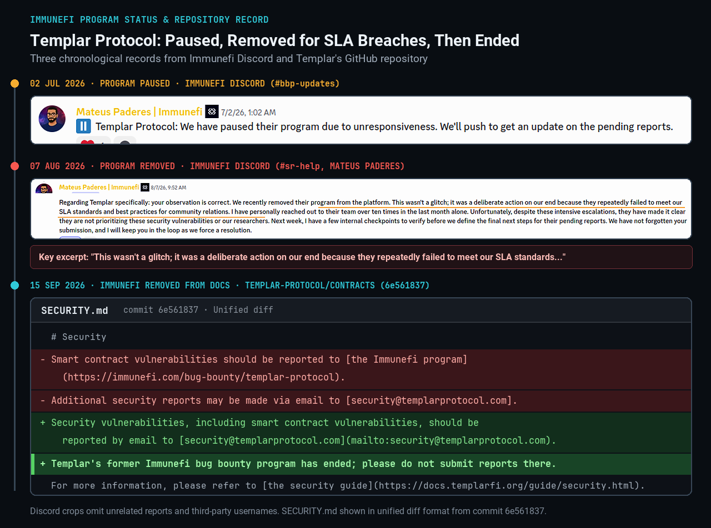

Supporting evidence for [Templar Protocol (NEAR): Keyless Withdrawal-Queue Freeze & Unpaid $100K Ruling](/templar-protocol-near-withdrawal-queue-freeze/). This page preserves the full deployment census, keyless-market accounting, disclosure chronology, and verification commands without interrupting the technical narrative.

Timeline dates are shown as recorded in the source screenshots and exports; clock times are omitted there. On-chain block heights remain the authoritative record.

## 1. Deployment record: 22 keyed markets

The census below was taken at block **218,233,933 on October 2, 2026**, before the October 7–8 redeployments. Values are the displayed, converted amounts from the investigation record. The aggregate reported in that source is **$15,402,321.89 (approximately $15.40M)**. Individual rounded rows do not add to that aggregate exactly.

Mainnet metadata labels the deployed bytecode **v1.6.0**, code hash `7WUFT7JR2mbKhQkPNedLL3ZZ28arqbwAFFubaMQpRpPW`, NEP-330 revision `07e20fc7`. That revision was not found as a public commit. The public bounds patch is [PR #659](https://github.com/Templar-Protocol/contracts/pull/659), commit [`dbfcd42b`](https://github.com/Templar-Protocol/contracts/commit/dbfcd42b4ee5565bffc05e652c07af463a2bdd19). This evidence does not establish that the deployed WASM is byte-identical to that PR.

| # | Market | Supply at Oct 2 | Deployed (UTC) | Links |
| ---: | --- | ---: | --- | --- |
| 1 | `iethwbtc-ixlmusdc.v1.tmplr.near` | $5,167,284.41 | 2026-10-08 14:42 | [Contract](https://nearblocks.io/address/iethwbtc-ixlmusdc.v1.tmplr.near) \| [Deploy Tx](https://nearblocks.io/txns/8K4haRvTrsqPKyKrZihTfcoxen125LJW4djGghMS1d4X) |
| 2 | `ibtc-ixlmusdc.v1.tmplr.near` | $3,408,420.24 | 2026-10-08 14:39 | [Contract](https://nearblocks.io/address/ibtc-ixlmusdc.v1.tmplr.near) \| [Deploy Tx](https://nearblocks.io/txns/8b1e26A2uqeB1NUZGE6cd3LCXdmdKgbyjhqbVQY2AA6h) |
| 3 | `ixlmdejaaa-ixlmusdc-1.v1.tmplr.near` | $3,239,143.57 | 2026-10-08 14:12 | [Contract](https://nearblocks.io/address/ixlmdejaaa-ixlmusdc-1.v1.tmplr.near) \| [Deploy Tx](https://nearblocks.io/txns/VmJUCttpp2EWNDPmAMBX8TmgxiU61rQp12DRfwxut8Q) |
| 4 | `ixlm-ixlmusdc-1.v1.tmplr.near` | $1,441,662.99 | 2026-10-08 14:37 | [Contract](https://nearblocks.io/address/ixlm-ixlmusdc-1.v1.tmplr.near) \| [Deploy Tx](https://nearblocks.io/txns/EgBhp8qjssqZUZzGqHYBT7kHwnrVJKV7Zf4w16m8Xtco) |
| 5 | `ibtc-iethusdc-1.v1.tmplr.near` | $1,042,748.46 | 2026-10-08 14:39 | [Contract](https://nearblocks.io/address/ibtc-iethusdc-1.v1.tmplr.near) \| [Deploy Tx](https://nearblocks.io/txns/2o21kqzeJRLDNiY4vkX2dU2iDBNS96Ft4jp2FizPBCib) |
| 6 | `ixlmdejaaa-ixlmusdc-2.v1.tmplr.near` | $400,000.90 | 2026-10-08 14:13 | [Contract](https://nearblocks.io/address/ixlmdejaaa-ixlmusdc-2.v1.tmplr.near) \| [Deploy Tx](https://nearblocks.io/txns/A1EioHhSvFW8x92CJ85HJQaWy9cqs5qdcXRow4wJsCRm) |
| 7 | `ixlmsolvbtc-ixlmusdc.v1.tmplr.near` | $100,005.10 | 2026-10-08 14:30 | [Contract](https://nearblocks.io/address/ixlmsolvbtc-ixlmusdc.v1.tmplr.near) \| [Deploy Tx](https://nearblocks.io/txns/7hye1r2o34o86nKXESWEJy57Qi7GbDcLY3Xtafndhidp) |
| 8 | `ixrp-ixlmusdc.v1.tmplr.near` | $100,003.35 | 2026-10-08 14:32 | [Contract](https://nearblocks.io/address/ixrp-ixlmusdc.v1.tmplr.near) \| [Deploy Tx](https://nearblocks.io/txns/FHXugQ3KxbXjGmfAdKzuSqNey9mUDhChXLDHkXDxMXBa) |
| 9 | `izec-ixlmusdc.v1.tmplr.near` | $100,000.14 | 2026-10-08 14:33 | [Contract](https://nearblocks.io/address/izec-ixlmusdc.v1.tmplr.near) \| [Deploy Tx](https://nearblocks.io/txns/F8sLiTRsq988AGfXJUYaokgeCihR24CsVTeoGPzic4er) |
| 10 | `ixlmcetes-ixlmusdc.v1.tmplr.near` | $100,000.11 | 2026-10-08 14:14 | [Contract](https://nearblocks.io/address/ixlmcetes-ixlmusdc.v1.tmplr.near) \| [Deploy Tx](https://nearblocks.io/txns/5PwgR6a8FCsBsqxgPVGTM9MepRagPyvFCwJbkCrNPx4V) |
| 11 | `ixlmustry-ixlmusdc.v1.tmplr.near` | $100,000.05 | 2026-10-08 14:31 | [Contract](https://nearblocks.io/address/ixlmustry-ixlmusdc.v1.tmplr.near) \| [Deploy Tx](https://nearblocks.io/txns/4rBCDbieM5ZeNaWUfXpmR52QZJ4jdDMnBvzfphqMijLw) |
| 12 | `iada-ixlmusdc.v1.tmplr.near` | $100,000.04 | 2026-10-08 14:37 | [Contract](https://nearblocks.io/address/iada-ixlmusdc.v1.tmplr.near) \| [Deploy Tx](https://nearblocks.io/txns/F7iYBLFY8w4nvWuCJ8yiLKer9ZceLBovwUZ7XvQVZc8P) |
| 13 | `idoge-ixlmusdc.v1.tmplr.near` | $100,000.04 | 2026-10-08 14:40 | [Contract](https://nearblocks.io/address/idoge-ixlmusdc.v1.tmplr.near) \| [Deploy Tx](https://nearblocks.io/txns/Hv93AaDLa1Fuo4qaCmd4qSbeGsa9owb6sFCmUTrp5tSC) |
| 14 | `iethhemibtc-iethusdc.v1.tmplr.near` | $1,031.60 | 2026-10-08 14:41 | [Contract](https://nearblocks.io/address/iethhemibtc-iethusdc.v1.tmplr.near) \| [Deploy Tx](https://nearblocks.io/txns/9cNewF8SuXvceUipQVDiqsFfCXCo5UK8Qqcfzb9Mm3GW) |
| 15 | `iethfxrp-ixlmusdc.v1.tmplr.near` | $1,001.20 | 2026-10-08 14:40 | [Contract](https://nearblocks.io/address/iethfxrp-ixlmusdc.v1.tmplr.near) \| [Deploy Tx](https://nearblocks.io/txns/2YyZwoZ3MBHFNr59wyMCA1PiK7j5xV81XSETirFBhTvC) |
| 16 | `iltc-ixlmusdc.v1.tmplr.near` | $1,001.00 | 2026-10-08 14:42 | [Contract](https://nearblocks.io/address/iltc-ixlmusdc.v1.tmplr.near) \| [Deploy Tx](https://nearblocks.io/txns/F5PAKY5JikZUNtUo3KXWER6n7nkMtjnPE2pHJgbkgJsR) |
| 17 | `ixlmdejtrsy-ixlmusdc.v1.tmplr.near` | $5.82 | 2026-10-08 14:11 | [Contract](https://nearblocks.io/address/ixlmdejtrsy-ixlmusdc.v1.tmplr.near) \| [Deploy Tx](https://nearblocks.io/txns/B9sT66raXpou5GBu3uS5oaPaJPj2rNSQ4YpbnD1w1uAc) |
| 18 | `ixlmdejaaa-ixlmusdc.v1.tmplr.near` | $5.26 | 2026-10-08 14:10 | [Contract](https://nearblocks.io/address/ixlmdejaaa-ixlmusdc.v1.tmplr.near) \| [Deploy Tx](https://nearblocks.io/txns/FVypgf3NV1NBVwkd4BvUeSBP9MoaGxauirZzumkhsjpt) |
| 19 | `linear-usdt.v1.tmplr.near` | 3.50 USDT | 2026-10-07 22:24 | [Contract](https://nearblocks.io/address/linear-usdt.v1.tmplr.near) \| [Deploy Tx](https://nearblocks.io/txns/347SQ4XbPt87TqMEjpp2wwiaoZLKZvm2XX3rEfu1dwSb) |
| 20 | `stnear-usdt.v1.tmplr.near` | 3.00 USDT | 2026-10-08 14:12 | [Contract](https://nearblocks.io/address/stnear-usdt.v1.tmplr.near) \| [Deploy Tx](https://nearblocks.io/txns/2zeRzrmNg3S7Phm1Ve5msA5NSho3ucDRcNEPdApJifki) |
| 21 | `ixlm-ixlmpyusd.v1.tmplr.near` | 2.16 PYUSD | 2026-10-08 14:43 | [Contract](https://nearblocks.io/address/ixlm-ixlmpyusd.v1.tmplr.near) \| [Deploy Tx](https://nearblocks.io/txns/8YQ7cCL4N254uusUoXH61J3A29rjg5HLfAogDU7zu6K5) |
| 22 | `ixlmdejtrsy-ixlmusdc-1.v1.tmplr.near` | $0.00 | 2026-10-08 14:29 | [Contract](https://nearblocks.io/address/ixlmdejtrsy-ixlmusdc-1.v1.tmplr.near) \| [Deploy Tx](https://nearblocks.io/txns/2MNQRwCXEcVDqveVYSDm5uH9T7t2tSkRDobPNHEMnztr) |

The two keyless accounts discussed in the main article were not part of these 22 deployments.

## 2. Keyless market: July migration and residual positions

On January 19, 2026, block 181,696,954, `ixlm-ixlmusdc.v1.tmplr.near` deleted `ed25519:5gEdy3qyZBZveGfcxcUTGCoVzzKnZXaQASWjmyP44giZ` in [`5PPCjn583spZKptMEo1gYN4zuhCRhnWKwsTKxag3FQFd`](https://nearblocks.io/txns/5PPCjn583spZKptMEo1gYN4zuhCRhnWKwsTKxag3FQFd). Immunefi counted 114 days between that deletion and the May 13 filing.

The successor `ixlm-ixlmusdc-1.v1.tmplr.near` was deployed on July 14, 2026 by `v1.tmplr.near` in [`F4Eh6Bo6A1ufY6DLGXdHgYmJBXvHdrd5JdKc1mTGjBRU`](https://nearblocks.io/txns/F4Eh6Bo6A1ufY6DLGXdHgYmJBXvHdrd5JdKc1mTGjBRU). It retained a full-access key and changed the withdrawal minimum from 0.04 to 1.00 USDC.

Both withdrawals were signed by the implicit account `80635cbbea3bc03a112c72a30ad94059213a253db65f549c8c406e707d730054`:

| When (UTC) | Action | USDC | Block / transaction |
| --- | --- | ---: | --- |
| Jul 16, 20:15 | Withdraw from keyless market | 1,084,536.1225777 | 207,255,140 / [Tx](https://nearblocks.io/txns/J4RiS87shhxTjr3iWehUhngUFUuKPhNirUm197Vj5WRp) |
| Jul 16, 20:27 | Supply to successor | 1,084,536.12 | 207,255,899 / [Tx](https://nearblocks.io/txns/3kg2ddiRo85mb6NrsMQTE4Ze42bV7k9XZs5tqxigeUgT) |
| Jul 27, 17:00 | Withdraw from keyless market | 357,091.0044225 | 208,788,406 / [Tx](https://nearblocks.io/txns/HpjroLktcytDkgFtenRc28ZTY2cUYEvszsrpfBkXVWt4) |
| Jul 27, 17:04 | Supply to successor | 357,091.00 | 208,788,791 / [Tx](https://nearblocks.io/txns/5mpWq6CJeqSxP4cnLLaHUv5bAx8s4nzBHk6F8J1sW8ci) |

The exact withdrawals total **1,441,627.1270002 USDC**. The displayed successor deposits total **1,441,627.12 USDC**, approximately 96 percent of the submission-time supply used by mediation.

### Funding and residual positions

Three records establish an initialization and gas-funding path:

1. Block 171,233,785, [`3D76DGqzaGhLvV6fdhqQ6FyoZHTwK1Q6ue65tkt7ortN`](https://nearblocks.io/txns/3D76DGqzaGhLvV6fdhqQ6FyoZHTwK1Q6ue65tkt7ortN): `templarllc.near` transferred 2.0 NEAR to `simrat.near`.
2. Block 172,489,440, [`AFyWbs2ysyQJTSfwNEYXfDaQLRhm3rMSrLYKgLk8nYtv`](https://nearblocks.io/txns/AFyWbs2ysyQJTSfwNEYXfDaQLRhm3rMSrLYKgLk8nYtv): `team.herewallet.near` initialized `80635cb…`.
3. Block 172,489,521, [`EiYoieskajddQPRMU68eHp2yFffG8ZaHamHopdaUUg1Z`](https://nearblocks.io/txns/EiYoieskajddQPRMU68eHp2yFffG8ZaHamHopdaUUg1Z): `simrat.near` transferred 0.8 NEAR to `80635cb…`.

`80635cb…` then supplied 1,500,000 USDC in [`EgDkqFBYyUzX9VxGB6kyJD2fWzv9aK1fZufx5X145p6q`](https://nearblocks.io/txns/EgDkqFBYyUzX9VxGB6kyJD2fWzv9aK1fZufx5X145p6q). These records establish a funding path, not beneficial ownership, present common key control, or who authorized the July transactions.

At block 219,400,038, and again around blocks 223,518,994–223,519,017, the keyless market had **59,137.9738191 USDC** active supply. At the later snapshot, the borrowed amount was **18,090.1807530 USDC**, the borrow-side `available` metric was **40,456.4133279 USDC**, and the queue length was 0. Listed supply positions included:

- `80635cb…`: **58,372.8818437 USDC** active, plus **853.6169686 USDC** accrued yield.
- `simrat.near`: **755.60 USDC** active.
- The other 13 listed accounts: approximately **2.3 USDC** active, plus small incoming amounts.

At the July 27 snapshot, **54,985.25 USDC**, approximately 93 percent of the pool, was borrowed. Repayments and one liquidation returned **37,079.75 USDC** between July 30 and August 20, reducing active borrows to about **18,090.18 USDC** and increasing liquid assets. Neither the historical repayment figure nor the borrow-side `available` metric guarantees a particular future withdrawal.

## 3. Disclosure timeline

Dates below are shown without clock times to avoid conflating dashboard display time with UTC on-chain time. The underlying screenshots retain their original timestamps.

- **May 13, 2026.** #77956 filed and escalated with Immunefi. The initial filing focused on v1.3.0 and the keyed `ibtc-iethusdc-1.v1.tmplr.near` market.
- **May 16, 2026.** An update titled "Extended Impact Scope: $4.75M at Risk Across 18 Markets" expanded the analysis to v1.2.0, v1.2.1, and v1.3.0 and included the keyless XLM/USDC market at approximately $1.50M.
- **May 25, 2026.** Mediation requested.
- **June 8, 2026.** [Templar's public migration map](https://x.com/TemplarProtocol/status/2064025413656207577) listed `ixlm-ixlmusdc` as TBD.
- **June 24, 2026.** On the ticket, severity was moved from Critical to Medium on a griefing theory.
- **June 29, 2026.** Templar wrote that it was evaluating whether a fix was necessary. The keyless XLM/USDC and isolated-ZEC markets had zero access keys.
- **July 2, 2026.** Immunefi paused Templar's program for unresponsiveness.
- **July 8–9, 2026.** Direct warning to RoyalF00l about the keyless market. The July 9 reply is quoted in the main article.
- **July 14, 16, and 27, 2026.** Keyed successor deployed; approximately **$1.44M USDC** moved. The [July 15 migration map](https://x.com/TemplarProtocol/status/2077405583893057943) named the successor.
- **August 7, 2026.** Immunefi removed Templar's program for repeated SLA failures.
- **September 13, 2026.** An Immunefi staff DM initially said publication was possible because the project was not responding.
- **September 15, 2026.** Commit [`6e561837`](https://github.com/Templar-Protocol/contracts/commit/6e561837d0e78cf59e0fc61ebe82a871c81f4371) changed `SECURITY.md`: "Templar's former Immunefi bug bounty program has ended; please do not submit reports there."
- **September 22, 2026.** I sent Templar a formal public-disclosure warning.
- **September 26, 2026.** RoyalF00l wrote that Certora had verified the findings and fix and requested a Medium-tier invoice. I rejected Medium and restated the keyless market's permanence.
- **September 28, 2026.** RoyalF00l accepted that the finding was valid but argued Medium/Griefing, the 1,000 TGas limit, and L-05.
- **September 29–30, 2026.** Immunefi requested a full-gas local-fork test. The September 30 run hit the 4 MB per-receipt recorded-storage-proof limit at 734.8 TGas.
- **October 1, 2026.** Mediation corrected the publication record: confidentiality had not been released.
- **October 2, 2026.** Templar confirmed the mechanism, according to the final determination.
- **October 7–8, 2026.** Twenty-two keyed markets received bytecode labeled v1.6.0.
- **October 8, 2026.** RoyalF00l argued the May proof used a superseded 300 TGas limit, cited L-05, and offered $2,500 as a goodwill payment.
- **October 9, 2026.** I declined the $2,500 and cited `a96e44d`, `ac072f1f`, and `08d32ef`.
- **October 22, 2026.** Final determination: Critical, **$100,000**, with Griefing, L-05, and Sybil rejected. Category 2 publication rights applied.
- **October 26, 2026.** I sent the determination and repeated the safety note. No reply is in that thread.
- **November 2, 2026.** I offered a **$60,000** settlement, open until November 8. The email referred to the keyless market but did not repeat the residual-supplier withdrawal warning.
- **November 11, 2026 (UTC) / November 11–12 (local PDF print).** `@RoyalF00l` offered **$3,000** (`15:44 UTC`) citing `L-05` and then (`20:17 UTC`) conditioned any payment on permanent non-publication of this write-up.

{: .shadow }
_Immunefi's July 2 pause and August 7 removal notices, followed by Templar's September 15 change to [`SECURITY.md`](https://github.com/Templar-Protocol/contracts/commit/6e561837d0e78cf59e0fc61ebe82a871c81f4371). Discord crops exclude unrelated reports and participants._

## 4. Independent verification

These commands inspect public state or local Git history. Output changes with chain state; use block-specific queries when comparing a historical snapshot.

Check both keyless accounts:

```bash
near account list-keys ixlm-ixlmusdc.v1.tmplr.near network-config mainnet now
near account list-keys izec-isolusdc.v1.tmplr.near network-config mainnet now
```

Inspect supply, borrowing, and the borrow-side `available` metric:

```bash
near contract call-function as-read-only \
  ixlm-ixlmusdc.v1.tmplr.near get_borrow_asset_metrics \
  json-args '{}' network-config mainnet now

near contract call-function as-read-only \
  izec-isolusdc.v1.tmplr.near get_borrow_asset_metrics \
  json-args '{}' network-config mainnet now
```

Check the withdrawal queues:

```bash
near contract call-function as-read-only \
  ixlm-ixlmusdc.v1.tmplr.near get_supply_withdrawal_queue_status \
  json-args '{}' network-config mainnet now

near contract call-function as-read-only \
  izec-isolusdc.v1.tmplr.near get_supply_withdrawal_queue_status \
  json-args '{}' network-config mainnet now
```

Check the deployed market metadata:

```bash
near contract call-function as-read-only \
  ixlm-ixlmusdc.v1.tmplr.near contract_source_metadata \
  json-args '{}' network-config mainnet now
```

For the Git history, work inside a clone of [`Templar-Protocol/contracts`](https://github.com/Templar-Protocol/contracts). The public bounds patch was squash-merged, so fetch the PR head before querying `dbfcd42b`:

```bash
git fetch origin pull/659/head
git show -s --format='%H | author %aI | commit %cI | %s' \
  a96e44dc9ed34f3251975a06a709ea94bd944922 \
  ac072f1fa475ef644f99e4ccffdbfded6d2b87c4 \
  08d32ef177fee011badb72766be79ddb085dd287 \
  dbfcd42b4ee5565bffc05e652c07af463a2bdd19
```

## 5. Primary sources

1. [Immunefi mediation determination, October 22, 2026](/assets/docs/templar/immunefi-77956-mediation-summary.pdf), SHA-256 `78e3e280bfa778f00233e6d27e68cc6415ec9e6a54db8f6c84bd491b70ad63fa`.
2. Certora, [*Security Assessment and Formal Verification Report, Templar Protocol*](https://certora.cdn.prismic.io/certora/acrOWJGXnQHGZG-h_Certora-Templar-SecurityAssessment-Audit%26FV-Reports.pdf), September 2025. Scope on page 4; L-05 on page 86.
3. Vulnerable revision [`e1f5b676`](https://github.com/Templar-Protocol/contracts/tree/e1f5b6766c8f69b2e89315241cf8f30a9caa3c4c); keyless source revision [`877cdf79`](https://github.com/Templar-Protocol/contracts/tree/877cdf7935a87f365deed8b3f51dcb268f36443c); public bounds patch [PR #659](https://github.com/Templar-Protocol/contracts/pull/659).
4. [NEP-509](https://github.com/near/NEPs/blob/master/neps/nep-0509.md); nearcore 2.11.0 [witness-size parameters](https://github.com/near/nearcore/blob/2.11.0/core/parameters/res/runtime_configs/69.yaml) and [Protocol 83 gas parameters](https://github.com/near/nearcore/blob/2.11.0/core/parameters/res/runtime_configs/83.yaml).

[Return to the technical analysis](/templar-protocol-near-withdrawal-queue-freeze/).
